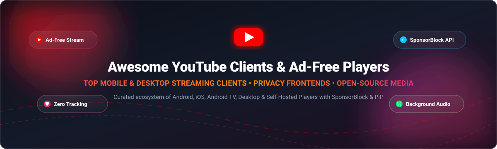

  

# 🎬 Awesome YouTube Clients & Mobile Ad-Free Players 🚀

  
  
  
  
  

---

## 🌟 Overview & Key Highlights

A curated directory of premier **SaaS video platforms** and **open-source YouTube alternative clients & ad-free media players** for Android, iOS, Android TV, macOS, Windows, Linux, and self-hosted cloud environments. Designed for privacy-conscious viewers, digital minimalists, cord-cutters, and media engineering teams seeking seamless ad-blocking, SponsorBlock segment skipping, background audio, Picture-in-Picture (PiP), local playlist management, and zero surveillance tracking.

### ⚡ Quick Navigation
- [📊 Sector Overview & Market Dynamics](#-sector-overview--market-dynamics)
- [☁️ SaaS/Hosted Platforms](#️-saashosted-platforms)
- [📱 Open-Source GitHub Projects](#-open-source-github-projects)
- [🛠️ Core Developer Libraries & Privacy Infrastructure](#️-core-developer-libraries--privacy-infrastructure)
- [🤝 How to Contribute](#-how-to-contribute)
- [💖 Support & Sponsorship](#-support--sponsorship)
- [📈 Star History](#-star-history)
- [⚖️ Disclaimer](#️-disclaimer)

---

## 📊 Sector Overview & Market Dynamics

The global online video streaming and creator media market is valued at approximately **$120 Billion to $150 Billion**, expanding at an estimated **18% to 22% CAGR**. Market dynamics are **heavily concentrated and winner-take-all**, where Alphabet's YouTube dominates user-generated streaming with over 2.7 billion monthly active users, creating a centralized ecosystem countered by a vibrant, distributed wave of privacy-first federated networks and independent, client-side open-source player innovations.

---

## ☁️ SaaS/Hosted Platforms

| Platform 🚀 | Starting Tier Pricing 💳 | Free Tier Limits / Trial Specifics ⏳ | Company Revenue / Valuation 🏢 | Primary Focus & Highlights 📝 |
| :--- | :--- | :--- | :--- | :--- |
| **[YouTube Premium](https://youtube.com)** | $13.99 / month (Individual Tier) | 30-Day Free Trial (1-Month trial with full ad-free, PiP, background play, and offline downloads; ongoing free access is ad-supported with video & banner interstitials) | ~$31.5B Revenue (Alphabet / YouTube ad & subscription run-rate; Alphabet market cap ~$2.1T) | Official Google subscription with multi-device background playback, downloads, and full YouTube Music Premium bundle. |
| **[YouTube Music](https://youtube.com)** | $10.99 / month (Music Premium) | 30-Day Free Trial (1-Month trial for background play and offline caching; permanently free tier is ad-supported without background playback) | ~$31.5B Revenue (Alphabet / YouTube ecosystem segment) | Cloud music streaming platform tightly integrated with official YouTube video catalogs, artist discographies, and playlists. |
| **[YouTube Kids](https://youtubekids.com)** | Free / Included with YouTube Premium ($13.99 / mo for ad-free) | 100% Free forever (ad-supported curated content filtered for kids; completely ad-free playback requires YouTube Premium family/individual plan) | ~$31.5B Revenue (Part of Alphabet / YouTube business unit) | Dedicated family-friendly video platform featuring algorithmic & human content filtering, screen-time timers, and age grouping. |
| **[Floatplane](https://floatplane.com)** | $3.00 / channel / month | 7-Day Free Trial (Per-channel trial period with full 4K/high-bitrate ad-free streams and chat; no permanent free tier) | ~$5M - $10M Revenue (Independent creator-owned platform by Linus Media Group) | High-bitrate, creator-funded streaming platform offering early access video drops, community chats, and zero third-party ads. |
| **[Nebula](https://nebula.tv)** | $5.00 / month ($50.00 / year) | 7-Day Free Trial (via creator partner promotional signups; zero permanent free tier; offers unlimited ad-free streaming & Nebula Originals) | ~$150M Valuation (Creator-owned streaming venture Standard Broadcast LLC) | Independent subscription service tailored for premier educational creators, video essays, podcast extensions, and original programming. |
| **[Odysee (Hosted)](https://odysee.com)** | $2.99 / month (Odysee Premium) | Free forever (Unlimited ad-supported viewing and video uploads up to 4GB per file; Premium removes banner ads and unlocks badge status & 1080p/60fps transcoding) | ~$10M - $25M Valuation (Decentralized video network built upon the LBRY protocol) | Web3-resilient, creator-centric video hosting network powered by decentralized protocols with seamless YouTube channel syncing. |

---

## 📱 Open-Source GitHub Projects

Explore the top open-source YouTube frontends and mobile clients, arranged in descending order by community GitHub_Stars.

| Repository & Client 📱 | GitHub_Stars ⭐ | Platform / Architecture 💻 | Description & Key Features 🛡️ |
| :--- | :---: | :--- | :--- |
| **[NewPipe](https://github.com/TeamNewPipe/NewPipe)** |  | Android | Ultra-lightweight, privacy-first native Android YouTube frontend operating without Google Play Services; supports background audio, PiP popup, offline downloads, and zero user profiling. |
| **[SmartTube](https://github.com/yuliskov/SmartTube)** |  | Android TV / Fire TV | Advanced open-source YouTube client engineered for TV displays and set-top boxes; features automatic SponsorBlock, 4K/8K 60fps HDR, VP9/AV1 codec tuning, and phone casting. |
| **[ReVanced Manager](https://github.com/ReVanced/revanced-manager)** |  | Android | Modular Android app patcher framework that unlocks ad-free playback, SponsorBlock segment skipping, AMOLED pure black themes, and background listening directly in mobile client binaries. |
| **[Invidious](https://github.com/iv-org/invidious)** |  | Self-Hosted Web / Crystal | Lightweight, self-hostable alternative web frontend written in Crystal; serves video streams stripped of Google analytics, tracking scripts, and proprietary JavaScript. |
| **[FreeTube](https://github.com/FreeTubeApp/FreeTube)** |  | Desktop (Windows, macOS, Linux) | Feature-rich desktop client built with Electron and Invidious/Local extraction APIs; provides multi-profile subscriptions, local history, SponsorBlock, and zero cloud tracking. |
| **[SimpMusic](https://github.com/maxrave-dev/SimpMusic)** |  | Android | Modern Material You YouTube Music player client with integrated SponsorBlock, real-time synchronized lyrics, offline audio caching, and Spotify canvas background integration. |
| **[LibreTube](https://github.com/libre-tube/LibreTube)** |  | Android | Sleek Material 3 YouTube client powered by public Piped backend instances; eliminates direct client connections to Google servers and natively includes SponsorBlock and DeArrow. |
| **[Piped](https://github.com/TeamPiped/Piped)** |  | Self-Hosted Web / Vue / Java | Ultra-fast privacy frontend and streaming proxy; routes video chunk traffic through self-hostable reverse proxies to shield user IPs from YouTube tracking. |
| **[ViMusic](https://github.com/vfsfitvnm/ViMusic)** |  | Android | Beautiful native Android music player that streams any song or playlist from YouTube Music with background playback, cached offline audio, lyrics, and equalizers. |
| **[PipePipe](https://github.com/InfinityLoop1308/PipePipe)** |  | Android | Highly optimized NewPipe fork with integrated SponsorBlock, Return YouTube Dislike, bullet comments (danmaku), and multi-platform parsing for Bilibili and NicoNico. |
| **[InnerTune](https://github.com/z-huang/InnerTune)** |  | Android | Material 3 YouTube Music client built with Jetpack Compose; features high-fidelity stream playback, background listening, dynamic audio normalization, and local playlist backups. |
| **[Yattee](https://github.com/Yattee/Yattee)** |  | iOS / iPadOS / tvOS / macOS | Privacy-first native Apple ecosystem video player running on Invidious and Piped backends; includes SponsorBlock, video queueing, Picture-in-Picture, and Apple TV compatibility. |
| **[Flow](https://github.com/Flow-Tube/Flow)** |  | Android | Modern Android client written in Jetpack Compose and Material 3; incorporates an on-device private algorithmic recommendation engine for customizable content feeds. |
| **[Tubular](https://github.com/polymorphicshade/Tubular)** |  | Android | Enhanced NewPipe fork with direct out-of-the-box SponsorBlock and Return YouTube Dislike integration while preserving clean upstream NewPipe core extraction updates. |
| **[Grayjay](https://github.com/futo-org/grayjay-android)** |  | Android | Source-available, anti-monopoly multi-platform media application from FUTO; aggregates subscriptions across YouTube, Twitch, PeerTube, and Odysee into unified ad-free feeds. |
| **[NouTube](https://github.com/nonbili/NouTube)** |  | Android / iOS / Desktop | Unified multi-platform YouTube and YouTube Music client that blocks promotional ads, enables background audio streaming, and lets users suppress Shorts and clickbait. |
| **[ViewTube (Web)](https://github.com/ViewTube/viewtube)** |  | Self-Hosted Web / Nuxt & Nest | Alternative YouTube web client built with Nuxt and NestJS; offers personalized accounts, local subscriptions, watch history tracking, and push notifications without Google accounts. |
| **[SongTube](https://github.com/SongTube/SongTube-App)** |  | Android | Elegant Flutter-based YouTube music and video application offering multi-format media conversions, album tag scraping, and background stream playing. |
| **[Clipious](https://github.com/lamarios/clipious)** |  | Android / Android TV | Clean Flutter-engineered mobile and TV client for Invidious instances; features SponsorBlock, DeArrow, gesture audio controls, and custom video resolution selections. |
| **[Litube](https://github.com/HydeYYHH/litube)** |  | Android | Modern Kotlin and Jetpack Compose mobile player driven by MediaServiceCore; offers seamless Shorts playback, background audio, and offline video storage. |
| **[OpenTubeX](https://github.com/OpenTubeX/OpenTubeX)** |  | Cross-Platform Desktop & Mobile | Privacy-centric open-source YouTube application featuring digital wellbeing watch time limits, Tor proxy network routing, and keyboard command palettes. |
| **[SmartTube Phone](https://github.com/shreyas-bangera/smarttube-phone)** |  | Android | Smartphone touch and portrait adaptation of SmartTube's engine; brings ad-free streaming, floating mini-player, sponsor skipping, and downloads to mobile handsets. |
| **[PlasmaTube](https://github.com/KDE/plasmatube)** |  | Linux Desktop & Mobile (KDE) | Official KDE ecosystem video client developed for Linux desktops and Plasma Mobile devices; connects cleanly via Invidious and Piped backend server APIs. |
| **[Astrionix ViewTube](https://github.com/Astrionix/ViewTube)** |  | Android | Native Android touchscreen client built upon SmartTube's core playback pipelines; includes SponsorBlock, DeArrow thumbnail replacement, and account sync without microG. |

---

## 🛠️ Core Developer Libraries & Privacy Infrastructure

Behind third-party YouTube clients and ad-free players is an ecosystem of open-source video downloaders, parser libraries, and crowdsourced filtering networks:

| Ecosystem Project 🛠️ | GitHub_Stars ⭐ | Role & Description 🔍 |
| :--- | :---: | :--- |
| **[yt-dlp](https://github.com/yt-dlp/yt-dlp)** |  | Highly capable CLI video downloader and stream extractor supporting thousands of media sites; powers the playback core of dozens of desktop and mobile applications. |
| **[PeerTube](https://github.com/Chocobozzz/PeerTube)** |  | Decentralized, federated ActivityPub video broadcasting and streaming platform; provides a peer-to-peer alternative to centralized platforms. |
| **[microG / GmsCore](https://github.com/microg/GmsCore)** |  | Free Software reimplementation of Google Play Services client libraries; allows Android users to log into YouTube and Google services without proprietary bloatware. |
| **[SponsorBlock](https://github.com/ajayyy/SponsorBlock)** |  | Crowdsourced browser extension and public REST API database allowing clients to automatically skip sponsored segments, intros, outros, and subscription reminders. |
| **[Return YouTube Dislike](https://github.com/Anarios/return-youtube-dislike)** |  | Open-source API and browser extension restoring public dislike counts and video ratings using archived statistics and extrapolated extension user votes. |
| **[YouTube.js (Innertube)](https://github.com/LuanRT/YouTube.js)** |  | Complete wrapper library for YouTube's private InnerTube API in JavaScript/TypeScript; enables stream resolution, playlist modification, and parsing without API keys. |
| **[DeArrow](https://github.com/ajayyy/DeArrow)** |  | Community-powered system that replaces clickbait, sensationalized video titles and deceptive thumbnails with accurate, representative community-submitted alternatives. |
| **[NewPipeExtractor](https://github.com/TeamNewPipe/NewPipeExtractor)** |  | High-performance Java stream extraction library powering NewPipe, Tubular, and third-party media players with direct stream scraping capabilities. |

---

## 🤝 How to Contribute

Contributions, project suggestions, and documentation enhancements are warmly welcomed! 🌟

1. 🍴 **Fork the Repository** on GitHub.
2. 🌿 **Create a Feature Branch**: `git checkout -b feature/add-new-client`.
3. 📝 **Add or Update Entries**: Follow the tabular layout in `README.md`, including precise starting pricing, free tier details, official GitHub repositories, and platforms.
4. 🚀 **Commit & Push**: `git commit -m "Add Awesome Client Name"` and push to your fork.
5. 📬 **Submit a Pull Request**: Detail your changes and why the tool benefits the ad-free and privacy streaming community.

---

## 💖 Support & Sponsorship

If you find this repository valuable for discovering privacy-focused media apps or building client software, please consider supporting its ongoing curation and maintenance:

- ⭐ **Star this repository** to help others discover it.
- 🍴 **Fork and share** with fellow developers, privacy advocates, and cord-cutters.
- ☕ **Buy a Coffee & Support via GitHub Sponsors**:  
    
  Visit the [GitHub Sponsors Dashboard](https://github.com/sponsors/ishandutta2007) to contribute directly.

Thank you to all community contributors, open-source maintainers, and privacy pioneers who make decentralized and ad-free video streaming possible! 🙏

---

## 📈 Star History

---

## ⚖️ Disclaimer

- This repository is a **community-curated educational index** and does not constitute an endorsement or legal counsel.
- Third-party frontends, scrapers, and extraction APIs may break intermittently due to upstream updates and changes by content distribution networks.
- Users and developers are solely responsible for adhering to local laws, intellectual property rights, and relevant platform Terms of Service in their applicable jurisdictions.
